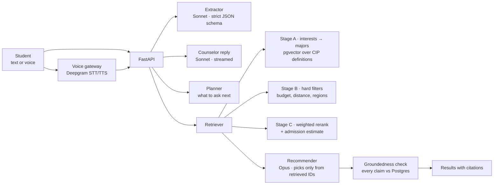

# College Matcher

A voice-and-text college counselor for US high school students. It talks with a student the way a good counselor would, builds a structured profile from the conversation, and recommends real bachelor's programs from the College Scorecard. Every school it recommends was retrieved from the database, and every number on a recommendation (net price, admit rate, test ranges, earnings) is checked against that database before it is shown. Numbers that fail the check are hidden. In conversation the counselor is told not to quote college statistics; that is a prompt rule, not a check.

**Stack:** FastAPI · Claude (Sonnet 5.5 for conversation and extraction, Opus 5.5 for recommendations) · Postgres 16 + pgvector · local embeddings (bge-small) · Deepgram (nova-3 STT, Aura-2 TTS) · React 18 + TypeScript + Tailwind · evals with simulated students and a labeled retrieval benchmark.

<!-- demo video link goes here -->

## Results

From [`docs/results.md`](docs/results.md): a live run of 36 simulated students, plus a labeled retrieval benchmark on 12 of them.

| Metric | Value |
|---|---|
| **Groundedness** (claims verified against the database) | **0.997** (1,499 / 1,504) |
| Recommended schools not in the retrieved set | 0 / 353 (enforced by the output schema) |
| Sessions reaching recommendations | 36 / 36 |
| Profile extraction precision / recall (all fields) | 0.88 / 0.73 |
| **Retrieval recall@10**, hybrid + rerank (gold profile / end-to-end) | **0.60 / 0.62** (was 0.31 / 0.35 before the retriever fix) |
| Turns per session (mean) | 10.3 |
| Cost per session (mean) | $0.21 (Sonnet turns + one Opus recommendation) |
| Reply time to first token, p50 / p95 | 1.9 s / 3.4 s |
| Retrieval latency, p50 | 0.12 s |
| Recommendation (Opus + retrieval + verification), p50 | 30 s |
| Voice time to first audio, median (7 live Deepgram turns) | 3.1 s (range 2.3–3.3 s) |

Groundedness, recommendation, cost and latency rows come from the live run, which used the retriever *before* the fix below. The recall rows re-run the fixed retriever offline on the same 36 conversations' saved profiles, with no new LLM calls. Recommendations were not regenerated on the fixed retriever.

*recall@10*: how many of the system's top 10 a judge marked acceptable, out of the most that could be (10, or fewer if fewer schools are acceptable). *nDCG@10*: the same, but rewarding acceptable schools ranked higher. *Gold* runs retrieval on the student's hidden true profile; *end-to-end* runs it on the profile the counselor extracted from the conversation.

**Retrieval ablation** (12 labeled students; every top-10 school judged):

| Mode | recall@10 gold | recall@10 end-to-end | nDCG@10 gold |
|---|---|---|---|
| SQL filters only | 0.18 | 0.29 | 0.16 |
| + vector search (interests → majors) | 0.44 | 0.59 | 0.44 |
| + transparent rerank | **0.60** | **0.62** | **0.56** |

With the full pipeline, end-to-end recall (0.62) matches recall on the hidden gold profiles (0.60), so on this benchmark extraction loses little and retrieval is the bigger lever. In the weaker modes end-to-end even scores above gold; with 12 labeled students, treat gaps of this size as noise.

**Read these numbers with the caveats.** The students are invented and played by a local model (Qwen 2.5 7B, a different family from the counselor). The relevance labels were judged by Claude Opus under a frozen rubric, not by a human. The judge saw a shuffled, source-blind pool and left a one-line rationale per school (except the final top-up, which was all system picks, so the labeler could tell their source), but it is the same model family as the recommender. Between a third and a half of the recall gain (about 36–43% on gold profiles, 45–52% end-to-end, depending on how the two rules' overlap is counted) comes from two product rules that mirror the labeling rubric: a default budget per income bracket, and a cap on far reaches. The location-honesty fixes, which the rubric does not mirror, are the largest single step. Full caveats are in [`docs/results.md`](docs/results.md) and [`evals/labels/criteria.md`](evals/labels/criteria.md).

## How it works



**The model chooses and explains; Postgres supplies every number; a deterministic checker verifies.**

- **Conversation.** Sonnet streams the counselor's reply. A separate Sonnet call extracts a profile delta into a strict JSON schema; each field carries a value, a confidence and the student's own words as evidence. A small planner picks the next topic: the "if money weren't involved…" question first, then interests, classes and strengths, activities, location, size and setting, priorities and money. It offers matches only once those are covered, and it honours an early "just show me schools" once it knows home state, income and interests.
- **Retrieval.**
  - **Stage A** embeds the student's interests and dream and matches them to CIP major definitions (the federal codes every college uses to report its majors) with pgvector.
  - **Stage B** applies hard filters in SQL. Budget uses the net price for the family's income bracket, with out-of-state publics priced at the out-of-state estimate. Then distance or regions.
  - **Stage C** reranks with transparent weights (major fit, cost, outcomes, admission fit, size and setting) and a deterministic admission estimator that labels Safety / Target / Reach only when GPA or test scores are known.
- **Honesty over coverage.** When the filters leave too few schools, the system returns fewer and says so ("Only 4 schools match everything you asked for…"). It never quietly widens the distance a student gave. The one allowed relaxation, an impossible budget raised to the bracket default, is disclosed with real numbers.
- **Recommendation.** Opus gets the top candidates and can only pick their IDs (the output schema enumerates them). It writes reasons as structured `{field, value}` claims, and every claim is verified against the database before display.
- **Voice.** Deepgram live STT over a WebSocket, sentence-by-sentence Aura-2 TTS, per-stage time-to-first-audio (TTFA: from the student finishing speaking to the first audio of the reply) instrumentation (t0–t5), and optional barge-in (`VOICE_BARGE_IN`). `VOICE_PROVIDER=fake` runs the full voice UI without a Deepgram key. Measured with `make voice-probe` over 7 live turns: median TTFA 3.1 s, of which the counselor's first token is about 2.3 s, the final transcript about 0.1 s and the first TTS audio about 0.45 s. The probe feeds synthetic macOS `say` speech and marks end of speech at the last audio frame, so a real browser's voice-activity detection adds its own delay on top; it doesn't play the audio either, so playback time is near zero.
- **Observability.** structlog JSON logs per stage with latency, tokens, cache reads/writes and cost. Every turn's metrics are persisted.

Design detail lives in [`docs/SPEC.md`](docs/SPEC.md): decisions log, contracts, ER and class diagrams, retrieval, admission tiers, eval protocol and voice pipeline.

## Evaluation

- **36 personas** ([`evals/personas/`](evals/personas)) with hidden profiles. They span articulate and vague students, low and high income, rural and urban, and edge cases such as impossible budgets, no test scores and undecided majors. Each is played by a local Qwen simulator with a leak guard that flags out-of-character slips and unprompted reveals.
- **Record and replay.** Every Claude call can be recorded to a cassette keyed by request hash. CI replays them at $0, and `make eval-replay` reproduces a 3-persona run offline.
- **Labeled retrieval benchmark.** The procedure is TREC-style pooling (the standard information-retrieval method: judge the union of every system's top results rather than the whole catalogue). Every retrieval mode's top 10 is pooled, on both gold and extracted profiles, together with a stratified sample. Hard criteria (H1–H4) are applied from the data. A soft fit score (S1) is judged blind with a frozen rubric. recall@10, nDCG@10 and judged-precision@10 are reported with the unjudged count.
- **What the benchmark found.** The first labeled run showed that the retriever's top 10 often broke what students had said: it silently widened distance limits, applied no budget at all when the student didn't name one, and let long-shot schools crowd the list. Fixing those behaviours, then re-scoring against the same labels, took recall@10 from 0.31 to 0.60.

## Run it locally

Requirements: Docker, [uv](https://docs.astral.sh/uv/), Node 20.19+. Optional: Ollama with `qwen2.5:7b-instruct` for live evals.

```bash
cp backend/env.example backend/.env      # add ANTHROPIC_API_KEY (and DEEPGRAM_API_KEY for voice)
cp web/env.example web/.env.local
DB_PORT=5433 make db-up                  # Postgres 16 + pgvector
make setup                               # backend deps (Python 3.12 via uv)
make data-sample                         # 200-school sample (the first API start downloads the ~70 MB embedding model)
make dev-api                             # http://localhost:8000
make dev-web                             # http://localhost:5173
```

Full dataset (2,343 bachelor's-granting schools, 67k programs): download the College Scorecard institution and field-of-study CSVs into `data/raw/scorecard/`, run `make data-cip-download`, then `make data`.

| Command | What it does |
|---|---|
| `make test` | 598 backend tests against a dedicated `*_test` database |
| `make lint` | ruff, ruff format, mypy |
| `make eval-replay` | 3-persona eval from committed cassettes ($0, no key) |
| `CONFIRM=1 make eval-live EVAL_MAX_COST=15` | all 36 personas live, with a hard budget guard; writes `docs/results.md` (needs the full dataset) |
| `make pool RUNS=<run>` / `make label` | labeling workflow |
| `make voice-probe` | live voice round trip against a running API; prints per-stage TTFA (needs `DEEPGRAM_API_KEY`, macOS) |

## Repository layout

```
backend/app/
  api/          REST + voice WebSocket
  counselor/    orchestrator, extractor, planner (context.py), recommender, notices (search_notes.py), prompts/
  retrieval/    embedder, SQL filters, pricing, rerank, admission estimator
  voice/        Deepgram STT/TTS, gateway, TTFA timing
  core/         config, LLM client (record/replay), cost table, logging
  db/           SQLAlchemy models + Alembic migrations
backend/ingest/ Scorecard + CIP loaders, embeddings
web/            React app (chat, voice orb, results)
evals/          personas, simulator, runner, metrics, report, labels/
docs/           SPEC.md, results.md, data_coverage.md
```

`client/` and `server/` are the original v1 prototype, kept for reference.

## Known limitations

- Scorecard data limits: program earnings exist for about 39% of programs (covering ~83% of graduates), and SAT/ACT ranges for under half of schools. These are shown as missing, never guessed.
- Only students are supported. No parent or counselor accounts, no saved lists, not hosted.
- "Far from home" is only partly modelled. The profile has no minimum-distance field.
- One labeler, and it is an LLM. There is no human inter-rater agreement yet.
