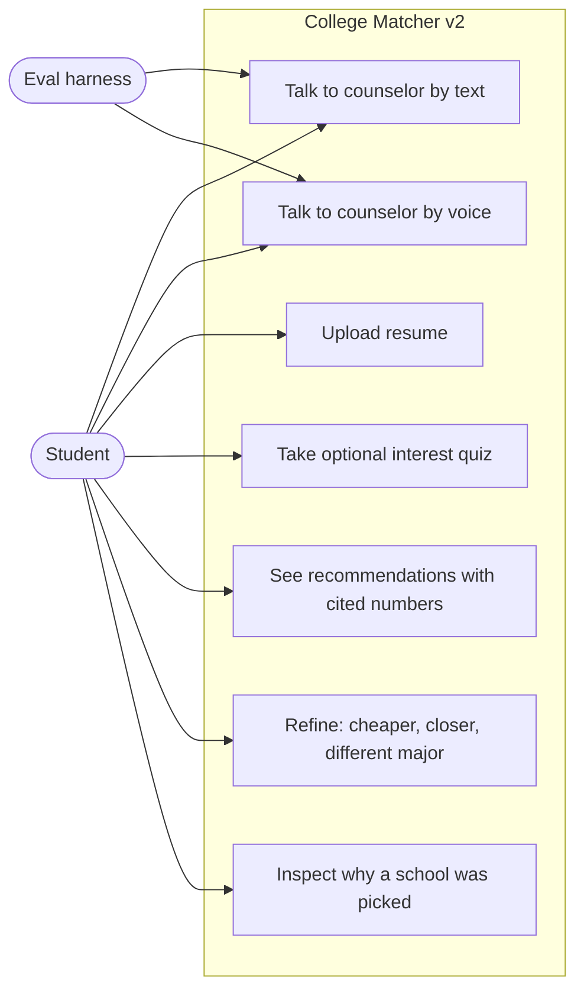
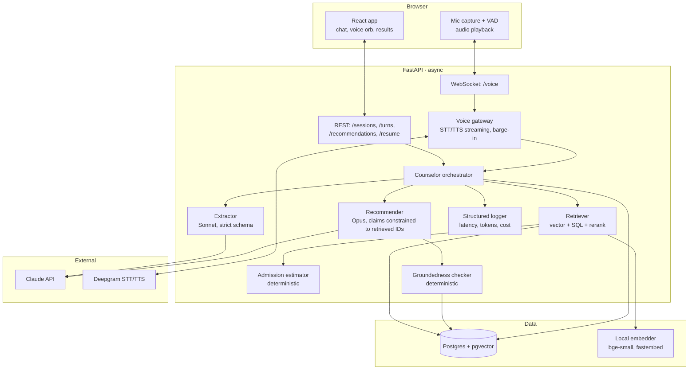
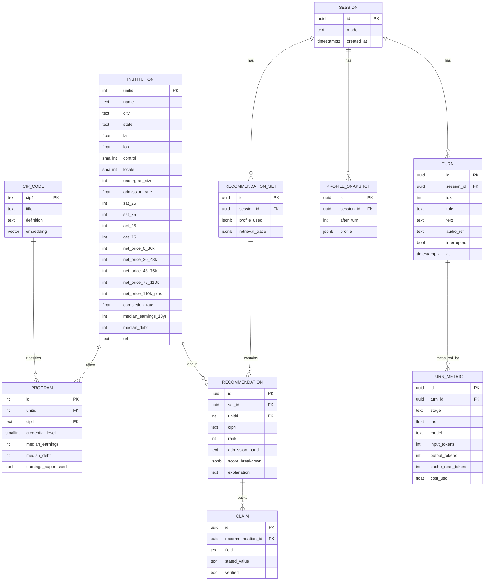
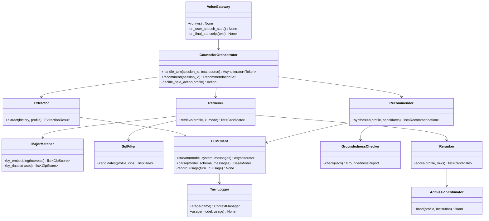
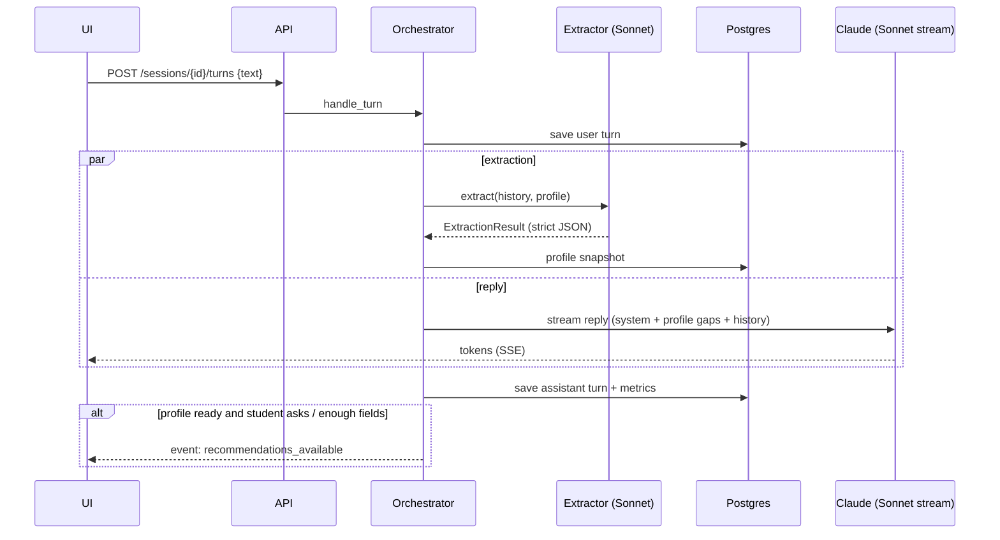
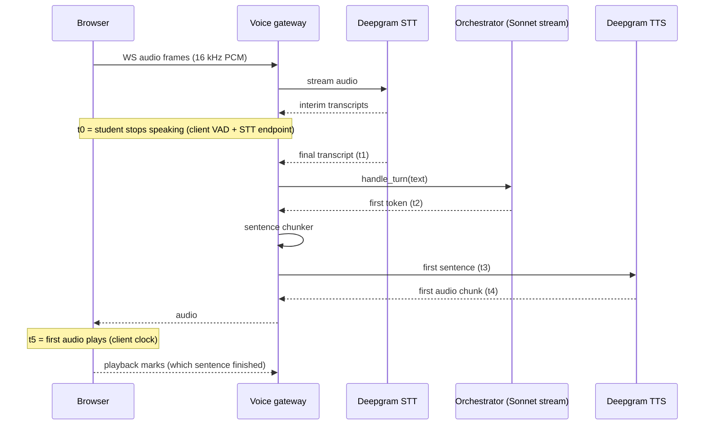

# College Matcher v2 — Spec & Design

> **Status:** draft for review · **Branch:** `v2` · **Target:** substantially done by Sun Nov 22, 2026 (application Mon Nov 23)
> **v0** (original JS MVP) is preserved at tag `v0-mvp` and on `master`.

## 0. One paragraph

A voice-and-text college counselor for **US high-school students** (students only — no counselor or parent views). The student talks; the counselor builds a structured profile from the conversation (each field backed by the student's own words), then recommends **bachelor's-granting US colleges and majors grounded in federal outcome data** (College Scorecard: net price by income, admission, completion, earnings and debt by major). Every factual claim in a recommendation cites a database row, and the system is measured: extraction accuracy, recall@10, groundedness, an ablation, and time-to-first-audio per stage.

---

## 1. Decisions log

### Locked
| # | Decision |
|---|---|
| D1 | Same repo, new branch `v2`; v0 tagged `v0-mvp` |
| D2 | Backend: Python 3.12 (pinned via `uv`; system Python is 3.15), FastAPI, async |
| D3 | DB: Postgres 16 + pgvector, run in Docker (DB only; API and web run natively in dev) |
| D4 | LLM: Claude. **Sonnet 5.5** (`claude-sonnet-5-5`) for conversation and per-turn extraction; **Opus 5.5** (`claude-opus-5-5`) for recommendation synthesis, admission reasoning, and resume parsing |
| D5 | Voice: **Deepgram** for streaming STT and TTS (one vendor, $200 free credit) |
| D6 | Scope: every currently-operating institution in the 50 states + DC offering ≥ 1 bachelor's program (public, private nonprofit, for-profit) — **2,343 schools** |
| D7 | Careers folded into majors and outcomes (Scorecard field-of-study + CIP taxonomy) |
| D8 | Ask for both GPA and SAT/ACT; trust self-report. Admission estimate weights test scores above GPA (§9) |
| D9 | Safety/Target/Reach shown only when GPA or test scores are present; labelled "estimated" |
| D10 | Interest quiz (Holland RIASEC, our own items) is **optional** for the student |
| D11 | Personas: 30–40 text personas; 8–10 also run through the voice pipeline |
| D12 | Not hosted. One-command `docker compose up`, demo video, results table at top of README |
| D13 | Frontend: React + Vite + TypeScript + Tailwind + shadcn/ui; minimal, calm, spacious |

### Proposed defaults — confirm or change
| # | Default | Alternative |
|---|---|---|
| P1 | Light theme by default, dark toggle | Dark by default (like allenvarghese.com) |
| P2 | Personas played by **local Qwen 7B via Ollama**, Sonnet fallback | Sonnet for personas |
| P3 | Embeddings: **local `BAAI/bge-small-en-v1.5`** (384-dim) via `fastembed` (ONNX, no PyTorch) | OpenAI `text-embedding-3-small` (< $0.01 total) |

---

## 2. Scope

**Tier 1 — must ship (the resume story)**
- Scorecard ingest (institutions + field of study) with coverage report
- Hybrid retrieval + 3-row ablation
- Text counselor: structured extraction with evidence, profile state, cited recommendations, admission estimate
- Eval harness: personas, labeled set, extraction P/R, recall@10 (gold-profile and end-to-end), groundedness
- Minimal clean web UI (chat + results)
- CI, structured logs (latency + cost per turn), replay mode
- README with results, demo video

**Tier 2 — should ship**
- Voice pipeline (Deepgram STT → Sonnet → Deepgram TTS) with time-to-first-audio per stage
- Voice-persona eval subset (TTFA + extraction delta voice vs text)
- Resume upload → parsed into profile
- Optional RIASEC quiz + RIASEC → O\*NET occupations → CIP majors path (4th ablation row)

**Tier 3 — cut first**
- Barge-in
- Dark mode polish, motion polish

**Out of scope:** auth/accounts, counselor/parent views, school browsing, reviews, hosting, non-US, graduate programs.

---

## 3. Use cases



The eval harness is a second actor: personas drive the same counselor API a student does.

---

## 4. Architecture



**Key principle:** the LLM never invents facts. Claude chooses and explains; Postgres supplies every number; a deterministic checker verifies.

### Repo layout
```
college-matcher/
├── backend/
│   ├── app/
│   │   ├── api/            # FastAPI routers (rest.py, voice_ws.py)
│   │   ├── core/           # config, logging, cost table, llm client
│   │   ├── counselor/      # orchestrator, extractor, recommender, prompts/
│   │   ├── retrieval/      # embed.py, sql_filters.py, rerank.py, admission.py
│   │   ├── voice/          # deepgram_stt.py, deepgram_tts.py, gateway.py
│   │   ├── db/             # models.py, session.py, migrations/ (alembic)
│   │   └── schemas.py      # Pydantic contracts (the source of truth)
│   ├── ingest/             # scorecard.py, cip.py, onet.py (tier 2)
│   ├── tests/
│   └── pyproject.toml
├── web/                    # React + Vite + TS
├── evals/
│   ├── personas/           # *.yaml hidden profiles
│   ├── labels/             # criteria.md + labels.yaml
│   ├── simulator.py        # persona player (Ollama Qwen / Sonnet)
│   ├── run.py              # text + voice runs
│   ├── metrics.py
│   └── recordings/         # replay cassettes
├── docs/SPEC.md            # this file
├── docker-compose.yml
├── Makefile                # make data, make dev, make eval, make test
└── .github/workflows/ci.yml
```

---

## 5. Data

### Sources
| Source | What | Notes |
|---|---|---|
| Scorecard institution file (`Most-Recent-Cohorts-Institution_11022026.zip`, 24 MB, released 2026-11-02) | One row per school: location, control, size, admission rate, SAT/ACT 25th–75th, net price by income bracket, completion, school-wide earnings and debt | |
| Scorecard field-of-study file (`Most-Recent-Cohorts-Field-of-Study_10152026.zip`, 34 MB) | One row per school × major (CIP 4-digit) × credential level: earnings and debt | **Privacy-suppressed for small cohorts. Earnings/debt cover federal-aid recipients only.** |
| NCES CIP 2020 taxonomy | Title + paragraph definition per major code | Text we embed |
| O\*NET occupations + RIASEC, NCES CIP–SOC crosswalk | Tier 2 RIASEC path | |

### Inclusion rule (D6) — verified
`CURROPER = 1` **AND** state in 50 states + DC **AND** ≥ 1 row with `CREDLEV = 3` (bachelor's) in the field-of-study file → **2,343 schools** (796 public, 1,286 private nonprofit, 261 for-profit). `HIGHDEG ≥ 3` was dropped from the rule: it admits 286 graduate-only schools (law, medicine, theology).

### Phase-2 go/no-go — done, see `docs/data_coverage.md`
- 67,029 bachelor's programs across 385 majors (CIP 4-digit).
- `EARN_MDN_4YR`: **39.3% of programs, 82.9% of graduates**. Debt (`DEBT_ALL_STGP_EVAL_MDN`): 35.3% of programs, 86.0% of graduates. Missing values are `PS` (privacy suppressed), concentrated in small programs.
- **Verdict under the pre-registered 40% rule: FALLBACK.** Kept as written. The product shows by-major earnings wherever they exist (most graduates' programs) and school-wide earnings, labelled, elsewhere. README line: *"By-major earnings for 39% of programs, covering 83% of graduates."*
- One horizon throughout: **`EARN_MDN_4YR`** (4 years after completion) for by-major; `MD_EARN_WNE_P10` (10 years after entry) for school-wide. Never compared to each other.

### Key columns (verified)
| Use | Column(s) |
|---|---|
| Identity / location | `UNITID, INSTNM, CITY, STABBR, ZIP, LATITUDE, LONGITUDE, LOCALE, INSTURL` |
| Type / size | `CONTROL, UGDS` |
| Admission | `ADM_RATE, OPENADMP, SATVR25/75, SATMT25/75, ACTCM25/75` |
| Net price by income | `NPT41..NPT45_PUB` / `NPT41..NPT45_PRIV` (brackets $0–30k, 30–48k, 48–75k, 75–110k, 110k+) |
| Outcomes (school) | `C150_4, MD_EARN_WNE_P10, GRAD_DEBT_MDN` |
| Outcomes (program) | `CIPCODE, CIPDESC, CREDLEV, EARN_MDN_4YR, DEBT_ALL_STGP_EVAL_MDN, IPEDSCOUNT1/2` |

Missing markers in these files are `NA` and `PS`; ingest maps both to NULL and keeps a `suppressed` flag.

### ER diagram


---

## 6. Contracts (Pydantic, abbreviated)

These live in `backend/app/schemas.py` and are written **before** parallel work starts. The web app's TypeScript types are generated from the OpenAPI schema.

```python
class Evidence(BaseModel):
    quote: str            # student's exact words
    turn_idx: int
    source: Literal["chat", "voice", "resume", "quiz"]

class Field[T](BaseModel):
    value: T | None = None
    confidence: float = 0.0   # 0..1, set by extractor
    evidence: list[Evidence] = []

class StudentProfile(BaseModel):
    # identity & location
    home_state: Field[str]
    home_zip: Field[str]
    # academics
    gpa: Field[float]                      # unweighted 0–4 if given
    sat: Field[int]
    act: Field[int]
    # money
    income_bracket: Field[Literal["0-30k","30-48k","48-75k","75-110k","110k+"]]
    budget_cap: Field[int]                 # $/yr, optional
    # interests & direction
    interests: Field[list[str]]            # free-text phrases
    dream_without_money: Field[str]        # "if money weren't involved…"
    intended_majors: Field[list[str]]
    riasec: Field[dict[str, float]]        # from quiz or inferred
    strengths: Field[list[str]]
    favorite_subjects: Field[list[str]]
    activities: Field[list[Activity]]      # clubs, sports, jobs, volunteering, leadership
    work_values: Field[list[str]]          # achievement, independence, recognition, relationships, support, working_conditions
    # fit preferences
    max_distance_miles: Field[int]
    regions: Field[list[str]]
    size_pref: Field[Literal["small","medium","large","any"]]
    setting_pref: Field[Literal["city","suburb","town","rural","any"]]
    priorities: Field[list[Literal["cost","outcomes","prestige","location","fit"]]]

class ExtractionResult(BaseModel):     # strict output of the per-turn extractor
    updates: dict[str, FieldUpdate]    # only fields this turn changed
    next_topic: str                    # which missing field to ask about next

class Claim(BaseModel):                 # every number shown to a student
    unitid: int                         # enum-constrained to retrieved IDs per request
    field: Literal["net_price","admission_rate","sat_range","completion_rate",
                   "program_median_earnings","program_median_debt",
                   "median_earnings_10yr","undergrad_size","city_state"]
    cip4: str | None = None
    value: str                          # as stated; checker parses and compares

class Recommendation(BaseModel):
    unitid: int
    cip4: str | None
    admission_band: Literal["safety","target","reach","unknown"]
    reasons: list[str]                  # short prose, no numbers
    claims: list[Claim]                 # all numbers live here
```

**Design rule:** prose (`reasons`) contains **no numbers**; every number is a `Claim`. This makes groundedness mechanical (§10).

**`regions` vocabulary (decided Nov 19):** lowercase US Census regions (`northeast, midwest, south, west`) and divisions (`new_england, mid_atlantic, east_north_central, west_north_central, south_atlantic, east_south_central, west_south_central, mountain, pacific`), two-letter USPS state codes, and `out_of_state` (any state except `home_state` — how "far from home" is expressed). The state mapping lives in `app/retrieval/geo.py`.

**Missing vs none:** a null field means "unknown". If a student says they have no GPA/test score, the field stays null (never invented); distinguishing "asked, none" from "never asked" is a tier-2 follow-up for the questions-asked metric.

---

## 7. Classes



---

## 8. Counselor behaviour

### Turn pipeline (text)


The reply and extraction run **in parallel** so extraction never adds latency. The reply prompt includes the profile as of the previous turn plus the list of missing fields; it's one turn behind, which is fine for choosing the next question.

### What the counselor asks (intake order, flexible)
1. Warm open: what's on your mind about college?
2. **"If money weren't involved and you weren't getting paid, what would you happily do for the rest of your life?"**
3. Interests, favourite subjects, strengths
4. Activities: clubs, sports, jobs, volunteering, leadership, things built
5. Work values (stability vs freedom, people vs things, recognition)
6. Academics: GPA, SAT/ACT ("optional — they help me estimate your chances")
7. Money: income bracket (Scorecard's five brackets), optional budget cap
8. Fit: home state/zip, distance, size, setting
9. Priorities: cost vs outcomes vs prestige vs location

**Readiness to recommend:** home_state + income_bracket + (interests or intended_majors) filled with confidence ≥ 0.6. Before that the counselor keeps asking; after it, the student can ask for results anytime.

**Recommendation-quality checklist (distinct from readiness; post-pilot).** Readiness gates the "see matches" button and is unchanged. Before the counselor *offers* matches on its own, it must have **asked** (answers optional, "no preference" accepted) about location preference (distance or regions), campus size/setting, and priorities. The next topic is planned deterministically (`context.plan_next_topic`) from the previous profile and the persisted `profile_snapshot.next_topic` history: dream → interests → home state → location preference → size/setting → priorities → money → offer matches → enrichment (academics, strengths, subjects, activities, work values). A topic is skipped once the profile covers it or once it was asked (no loops on a declined question; the one asked on the previous turn is not repeated while the student answers). A student who explicitly asks for schools ("just show me schools") skips the checklist. In practice the asked order follows the intake list above loosely; the planner, not the extractor's `next_topic`, steers the reply (`counselor_reply.v2`). The recommender never claims `city_state` (`recommender.v3`); location is shown from DB fields.

### Recommendation pipeline
```mermaid
sequenceDiagram
    participant ORCH as Orchestrator
    participant RET as Retriever
    participant DB as Postgres + pgvector
    participant REC as Recommender (Opus)
    participant GND as Groundedness checker

    ORCH->>RET: retrieve(profile, k=40)
    RET->>DB: vector search: interests → top CIP codes
    RET->>DB: SQL: in-scope schools offering those CIPs, hard filters
    RET->>RET: rerank (fit, cost, outcomes, admission band)
    RET-->>ORCH: 40 candidates + score breakdowns + rows
    ORCH->>REC: synthesize(profile, candidates) — unitid enum = candidate IDs
    REC-->>ORCH: 10 Recommendations (reasons + claims)
    ORCH->>GND: check(claims vs DB rows)
    GND-->>ORCH: verified flags; unverified claims dropped from UI, counted in metrics
```

Opus picks and explains, but **can only name schools that were retrieved** (schema enum), so invented schools are impossible by construction.

### Resume parsing (tier 2)
Upload PDF → Opus reads it as a document block → returns `ExtractionResult` with `source="resume"` evidence → merged into profile. Counselor then confirms ("I see you led robotics — tell me about that").

---

## 9. Retrieval and ranking

### Stage A — interests → majors
- **Embedding path (tier 1):** embed `interests + dream_without_money + strengths` → cosine top-k over CIP definitions.
- **RIASEC path (tier 2):** student RIASEC vector → O\*NET occupations by profile similarity → CIP via crosswalk.
- If `intended_majors` given, map those to CIP directly and union with the above.

### Stage B — hard filters (SQL)
In scope (D6) · offers ≥ 1 selected CIP at bachelor's level · net price at student's bracket ≤ budget cap × 1.15 (if cap given) · within distance/region if strict.

### Stage C — rerank
Transparent weighted score (weights shift with stated `priorities`), each component 0–1, shown in UI as a breakdown:

| Component | Signal |
|---|---|
| Major fit | Stage A similarity of the matched CIP |
| Affordability | net price at bracket vs cap (or vs bracket median if no cap) |
| Outcomes | program median earnings (fallback school-wide), debt-to-earnings |
| Admission fit | band from estimator; penalise reach-heavy lists |
| Preferences | distance, size, setting |

Final list balances bands (e.g. 2–3 safety, 4–5 target, 2–3 reach) when bands are known.

### Admission estimator (deterministic, labelled "estimated")
Data reality (`docs/data_coverage.md`): 95.7% of schools have an admission rate or are open-admission; only 43.7% report SAT/ACT ranges. So the estimator has tiers:

1. **Open admission** (`OPENADMP = 1`, 24.8% of schools) → **safety**, no test ranges needed (the student must still have shared a GPA or test score, per D9).
2. **Selectivity cap:** admission rate < 15% (60 schools) → always **reach**, regardless of stats.
3. **Test position** (student gave SAT/ACT and school reports ranges): below 25th → low, 25th–75th → mid, above 75th → high.
4. **GPA modifier** (if GPA): ≥ 3.8 nudges up one step, < 3.0 nudges down one step. Test scores dominate: GPA never moves more than one step.
5. **No usable test position** (student has no scores, or school reports no ranges): position from GPA tier only, combined with admission rate; marked **lower confidence**.
6. Map position + admission rate: high and admit ≥ 50% → safety; low → reach; otherwise target.
7. Student gave neither GPA nor test, or school has no admission signal (~4%) → `unknown`; the counselor offers to estimate if they share scores.

Scorecard has no school GPA data, so GPA is a modifier, not a comparison. README states this.

---

## 10. Evaluation

### Personas
`evals/personas/*.yaml` — each has a **hidden profile** (ground truth) and **reveal rules**:
```yaml
id: maya-oh
hidden_profile:
  home_state: OH
  income_bracket: 48-75k
  gpa: 3.6
  sat: 1310
  interests: [drawing, fixing bikes, how things are built]
  dream_without_money: "design things people use every day"
  max_distance_miles: 300
  priorities: [cost, outcomes]
style: "short answers, a bit unsure, says 'idk' sometimes"
reveal: only_when_asked      # never volunteer facts
```
Played by the simulator (local Qwen 7B via Ollama; Sonnet fallback if it breaks character in spot checks). A different model family plays the student than runs the counselor, which reduces self-flattering scores.

### Labeled set
- `evals/labels/criteria.md` written **before** labeling: hard criteria (in-state preference, net price ≤ X, admission band mix, offers major Z) **plus one soft rubric criterion SQL can't express** (fit with the student's stated interests and outcomes).
- Per persona, a candidate pool is generated from the hard criteria; the student owner (Allen) hand-marks acceptable schools using the soft rubric. ~2–3 hours for 30–40 personas.
- Called an **internal benchmark**, not ground truth, in the README.

### Metrics
| Metric | How | Deterministic? |
|---|---|---|
| Extraction precision/recall per field | final profile vs hidden profile; exact match for enums/numbers (tolerance for GPA ±0.05, SAT ±10), set overlap for lists | ✅ |
| recall@10 / nDCG@10 — **gold profile** | retrieval fed the hidden profile directly | ✅ |
| recall@10 / nDCG@10 — **end-to-end** | retrieval fed the extracted profile | ✅ |
| **Groundedness** | % of claims whose value matches the DB row (numeric tolerance 1%) | ✅ — **lead metric** |
| Hallucinated-school rate | schools not in retrieved set | 0 by construction; reported |
| Questions-asked coverage | % of hidden fields the counselor asked about | ✅ |
| Cost per session, turns per session | from turn metrics | ✅ |

The gap between gold-profile and end-to-end recall isolates how much extraction loses.

### Ablation
| Retrieval mode | recall@10 | nDCG@10 |
|---|---|---|
| SQL filters only | | |
| Hybrid (embedding majors + SQL) | | |
| Hybrid + rerank | | |
| Hybrid + RIASEC + rerank (tier 2) | | |

### Voice subset (tier 2)
8–10 personas: persona text → Deepgram TTS (synthetic student voice) → full voice pipeline. Report TTFA p50/p95 per stage and **extraction accuracy voice vs text** for the same personas.

### Replay mode
All Claude/Deepgram calls go through a client that can record to and replay from `evals/recordings/`. CI and reviewers run evals with **no API keys**. A full live run is a manual `make eval-live`.

---

## 11. Voice pipeline (tier 2)



**Time to first audio** = t5 − t0, measured on the client; server stage timestamps (t1–t4) are sent alongside so the breakdown sums to the total. Report p50/p95.

**Barge-in (tier 3):** client VAD detects speech while audio is playing → stop playback immediately → send `interrupt` → server cancels the LLM and TTS streams → assistant turn truncated to the **last sentence the client confirmed it played**, marked `interrupted=true`. History therefore reflects what the student actually heard.

---

## 12. Observability and cost

- `structlog` JSON logs, one record per stage per turn: `session_id, turn_id, stage, ms, model, input_tokens, output_tokens, cache_read_tokens, cost_usd`.
- Cost table in `core/cost.py` (per million tokens): Sonnet 5.5 $2 in / $10 out; Opus 5.5 $4 / $20; Deepgram per minute/character. One place to update.
- Prompt caching on the stable system prompt + tool/schema prefix.
- PII: logs record field **names** and lengths, never raw student text, by default (`LOG_PII=false`).

---

## 13. Guardrails

- Users are mostly minors: minimal data, no accounts, sessions deletable, no third-party analytics.
- Never promise admission; bands always say "estimated".
- Earnings caveat shown in UI: "federal-aid recipients only; some programs too small to report".
- Counselor stays on topic (college and majors); declines unrelated requests politely.

---

## 14. CI

GitHub Actions on every push/PR:
1. `ruff` + `mypy` (backend), `eslint` + `tsc` (web)
2. `pytest` with a committed **sample dataset** (≈ 200 schools) loaded into a pgvector service container
3. Eval smoke test in **replay mode** (5 personas) with thresholds (e.g. groundedness ≥ 0.95)
4. `docker compose config` validation

---

## 15. Build plan

### Phases
| # | Phase | Output |
|---|---|---|
| 1 | Foundation | uv project, FastAPI health route, compose with pgvector, alembic, structlog, CI green |
| 2 | Data | coverage check (go/no-go), ingest institutions + programs + CIP, embeddings, `make data` |
| 3 | Retrieval | Stage A/B/C, admission estimator, ablation runner on gold profiles |
| 4 | Text counselor | orchestrator, extractor, recommender, groundedness, REST + SSE |
| 5 | Evals | personas, criteria + labels, simulator, metrics, replay, results table |
| 6 | Voice | Deepgram STT/TTS, gateway, TTFA, voice-persona subset, (barge-in) |
| 7 | Web | design system, chat + voice orb + results + "why this school" |
| 8 | Ship | README, demo video, cleanup of v0 files |

### Schedule
| Day | Work |
|---|---|
| Thu night | Spec sign-off · phase 1 · contracts (`schemas.py`, DB models, API shapes) |
| Fri | Phase 2 → 3 (data agent, retrieval agent) ∥ phase 4 skeleton (counselor agent) ∥ web shell (design agent) |
| Sat | Phase 4 complete · phase 5 (eval agent) · Allen labels personas · web results screen |
| Sun | Phase 6 voice · eval runs · README + video |
| Mon | Submit |

### Multi-agent plan (orchestrator: main session)
1. **Contracts first, in the main session:** `schemas.py`, DB models + migration, OpenAPI shapes, sample dataset fixture. Nothing parallel starts before this.
2. Then parallel agents, each in its own git worktree, merging back to `v2`:
   - **Data agent:** ingest + coverage report
   - **Retrieval agent:** stages A–C + estimator + ablation (uses the fixture until data lands)
   - **Counselor agent:** orchestrator, extractor, recommender, checker (retriever behind an interface)
   - **Web agent:** design system + screens against a mocked API
   - **Eval agent:** simulator, metrics, replay, persona authoring (Allen reviews and labels)
   - **Voice agent:** after the counselor's streaming API exists
3. Main session reviews every merge, runs tests, keeps this spec current.

---

## 16. Risks

| Risk | Mitigation |
|---|---|
| Field-of-study earnings too sparse | Go/no-go in phase 2; fall back to school-wide earnings |
| Labeling takes longer than planned | Cap at 30 personas; criteria-first makes labeling fast |
| Qwen 7B breaks character | Spot-check transcripts; switch personas to Sonnet |
| Voice latency poor | Report it honestly per stage; sentence-level TTS chunking; Sonnet only on voice turns |
| API spend exceeds ~$90 | Replay mode; small live runs; cost logged per turn |
| Python 3.15 package gaps | Project pinned to 3.12 via uv |

---

## 17. Open questions

1. P1–P3 above (theme default, persona model, embedding model).
2. Push `v2` branch and `v0-mvp` tag to GitHub now, or at the end?
3. Territories (Puerto Rico, Guam, etc., 70 schools) are excluded for now. Include them?
4. The embedding corpus needs the NCES CIP 2020 definitions file (the Scorecard file has only short titles for its 385 majors). One more download for `make data`.
